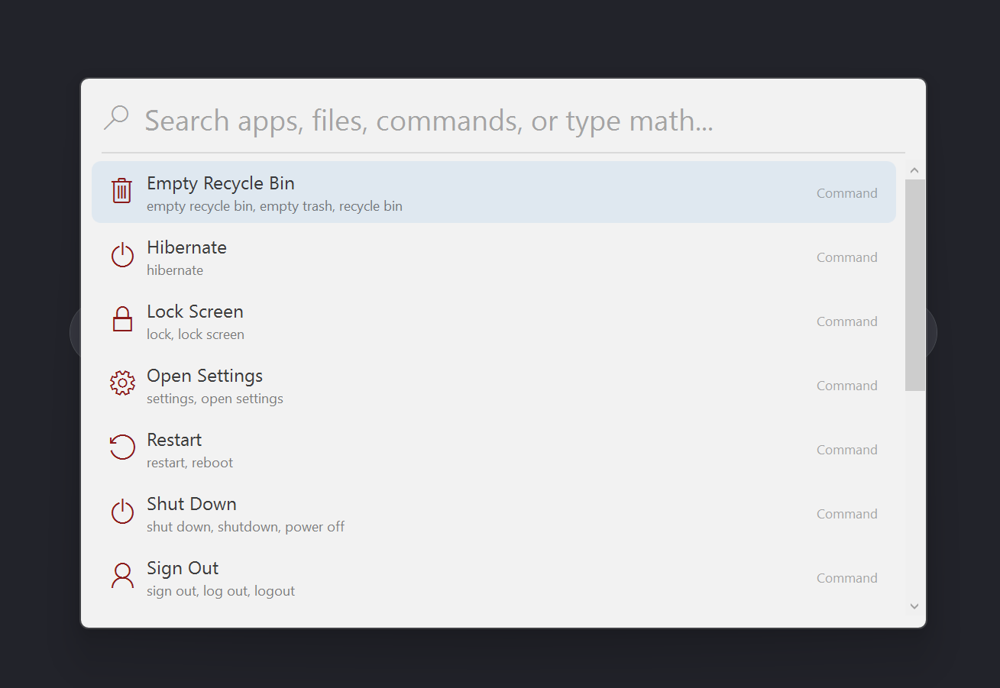
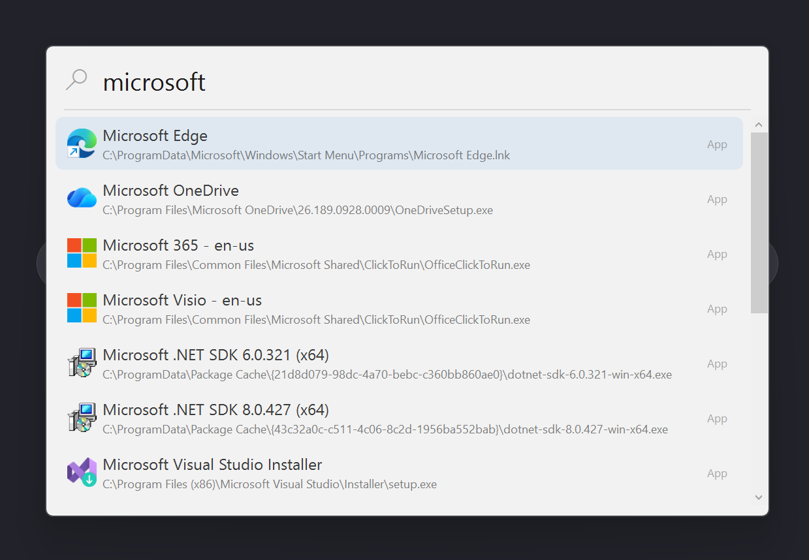

# WinSpotLight

WinSpotLight is a **Spotlight-style launcher for Windows**, inspired by
[macOS Spotlight](https://support.apple.com/guide/mac-help/search-with-spotlight-mchlp1008/mac).

Like Spotlight on the Mac, it runs quietly in the background and pops up a
centered search bar when you press a hotkey (default `Ctrl+Alt+Space` — the Windows
analogue of `⌘+Space`). Type to instantly search and launch apps, files, system
commands, or evaluate a calculation, all without touching the mouse.

## Screenshots





## Features

- Search installed apps and Start Menu shortcuts, files, system commands, and
  evaluate math expressions.
- Global hotkey (configurable via the tray menu → **Settings**).
- Single-instance: launching it again re-opens the existing search bar.
- "Run at startup" toggle in the tray menu.

## Build locally

```powershell
dotnet build -c Release
```

Pull requests run a CI build check (`.github/workflows/build.yml`) that must pass
before merging.

## Build the installer

Requires [Inno Setup 6](https://jrsoftware.org/isinfo.php). Publish first, then
compile the installer:

```powershell
dotnet publish WinSpotLight.csproj -c Release -r win-x64 --self-contained true -o publish
$env:APP_VERSION = "1.0.0"
& "C:\Program Files (x86)\Inno Setup 6\ISCC.exe" installer.iss
```

The setup executable is written to `dist\`.

## Releases

Pushing to `main` triggers the
[`.github/workflows/release.yml`](.github/workflows/release.yml) workflow, which
builds two installers and publishes them as a new GitHub release. The version is
auto-incremented from the latest `v*.*.*` tag (starting at `1.0.0`).

- `WinSpotLight-Setup-<version>.exe` — framework-dependent (smaller, but requires
  the [.NET 8 Desktop Runtime](https://dotnet.microsoft.com/download/dotnet/8.0)).
- `WinSpotLight-Setup-<version>-self-contained.exe` — self-contained (bundles the
  .NET runtime, no prerequisites).
